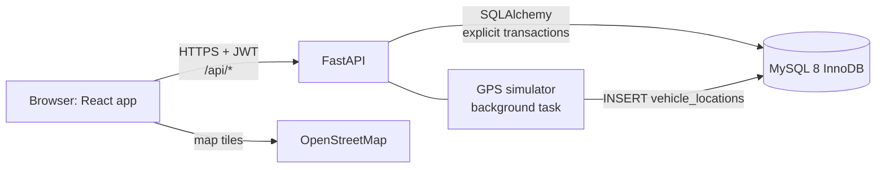
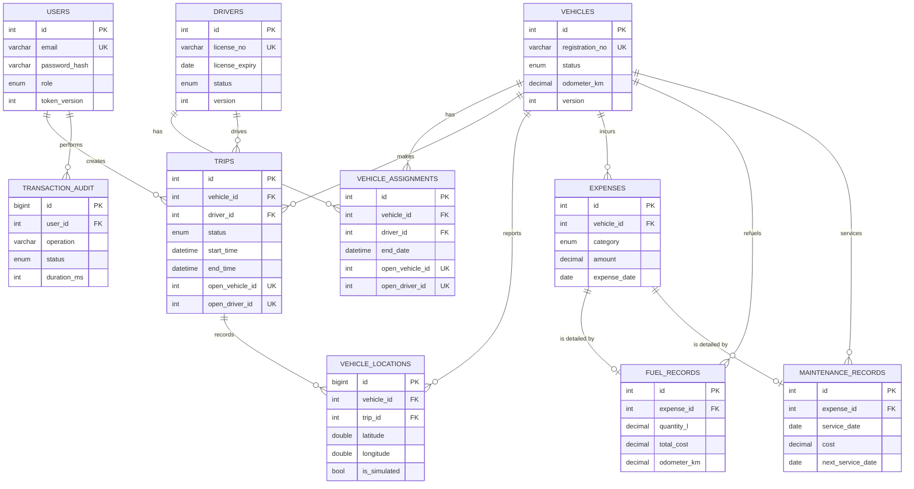
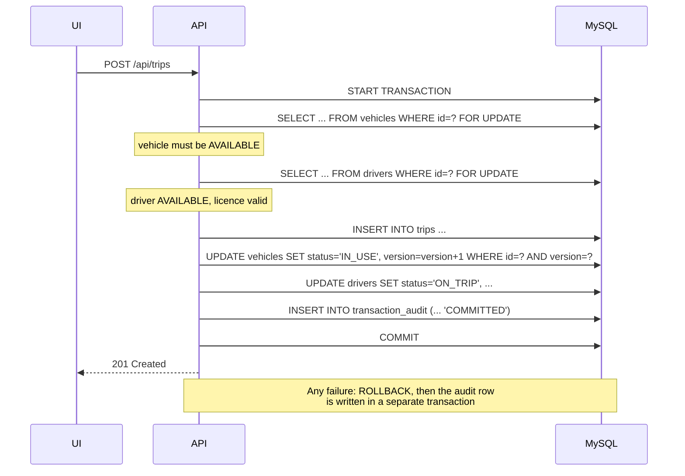

# TrackTech architecture

## System overview

The browser never talks to MySQL. Every request goes through FastAPI, which validates input with Pydantic, checks the JWT and the user's role, and then runs the database work inside one explicit transaction.

## Entity relationship diagram

## Normalisation notes

All tables are in third normal form. Two choices deserve explanation:

- **Expenses are the single ledger.** A fuel purchase is stored once as an `expenses` row (the money) and once as a `fuel_records` row (litres, price, odometer). The 1:1 link is enforced by a `UNIQUE` foreign key, and both rows are written in the same transaction. Reports sum one table instead of three.
- **Trips copy place names and coordinates.** This is deliberate denormalisation: a trip's history must not change if a preset place is later renamed or moved.

## Transaction design

### Creating a trip

### Three layers against double booking

| Layer | Mechanism | What it protects against |
|---|---|---|
| Pessimistic locking | `SELECT ... FOR UPDATE` on the vehicle and driver rows | Two requests assigning the same vehicle at the same moment |
| Optimistic locking | `version` column checked on every update | A user saving a form after someone else changed the record |
| Database constraint | `UNIQUE` on a generated column that holds `vehicle_id` only while the trip is open | Any bug in application code that slips past the first two |

MySQL has no partial indexes, so the third layer uses a `STORED` generated column that is `NULL` for finished trips. A `UNIQUE` index ignores `NULL`s, so only open trips compete.

### Deadlock avoidance

Every operation that locks more than one row locks them in the same order: trip, then vehicle, then driver. A cycle of transactions waiting for each other is impossible when everyone acquires locks in one global order, the same principle as resource ordering in operating systems. If MySQL still reports a deadlock (error 1213) or a lock timeout (1205), the API rolls back and returns HTTP 409 asking the user to retry.

### Isolation level

The project uses InnoDB's default, `REPEATABLE READ`. Plain `SELECT`s read a consistent snapshot. `SELECT ... FOR UPDATE` and `UPDATE` read the latest committed row and lock it. The conditional-update demo relies on this: User B's `UPDATE ... WHERE status = 'AVAILABLE'` re-reads the row after User A commits and matches zero rows.

### Audit trail

| Outcome | When the audit row is written | Why |
|---|---|---|
| Success | Inside the same transaction, just before COMMIT | The change and its record commit together, or neither does |
| Failure | After ROLLBACK, in a new transaction | Writing it inside the failed transaction would roll it back too |

The audit table never stores passwords, password hashes or tokens.

## Security summary

- Passwords are hashed with bcrypt (cost 12). Login takes the same time whether or not the email exists.
- Five failed logins lock that email for five minutes.
- JWTs are signed with HS256 and expire after two hours. Each token carries the user's `token_version`, and the API compares it on every request, so changing a password or role signs out every old session immediately.
- Roles are checked by the API on every protected route. The UI only hides controls.
- CSV exports prefix cells starting with `=`, `+`, `-` or `@` to prevent spreadsheet formula injection.
- The API connects to MySQL with an account that has only `SELECT, INSERT, UPDATE, DELETE`.
- Secrets live in `.env`, which is in `.gitignore`.

## API overview

The full, interactive reference is generated by FastAPI at `/docs`.

| Module | Endpoints |
|---|---|
| Auth | `POST /api/auth/login`, `POST /api/auth/token`, `GET /api/auth/me`, `POST /api/auth/change-password` |
| Users (admin) | `GET, POST /api/users`, `PATCH /api/users/{id}` |
| Dashboard | `GET /api/dashboard/stats` |
| Vehicles | `GET, POST /api/vehicles`, `GET, PUT, DELETE /api/vehicles/{id}`, `POST /api/vehicles/{id}/assign-driver`, `GET /api/vehicles/{id}/records` |
| Drivers | `GET, POST /api/drivers`, `GET, PUT, DELETE /api/drivers/{id}`, `GET /api/drivers/{id}/trips` |
| Trips | `GET /api/places`, `GET, POST /api/trips`, `GET /api/trips/{id}`, `PATCH /api/trips/{id}/status` |
| Tracking | `GET /api/tracking/live`, `GET /api/vehicles/{id}/location`, `GET /api/vehicles/{id}/history`, `GET /api/tracking/simulator` |
| Fuel and maintenance | `GET, POST /api/fuel-records`, `DELETE /api/fuel-records/{id}`, `GET, POST /api/maintenance`, `GET /api/maintenance/upcoming`, `DELETE /api/maintenance/{id}`, `GET, POST /api/expenses`, `DELETE /api/expenses/{id}` |
| Reports | `GET /api/reports/expenses`, `GET /api/reports/utilization`, `GET /api/reports/summary`, `GET /api/reports/export` |
| Transactions | `GET /api/transactions`, `POST /api/transactions/demo/commit`, `POST /api/transactions/demo/rollback`, `POST /api/transactions/demo/concurrency`, `POST /api/transactions/demo/reset`, `GET /api/transactions/consistency` |
